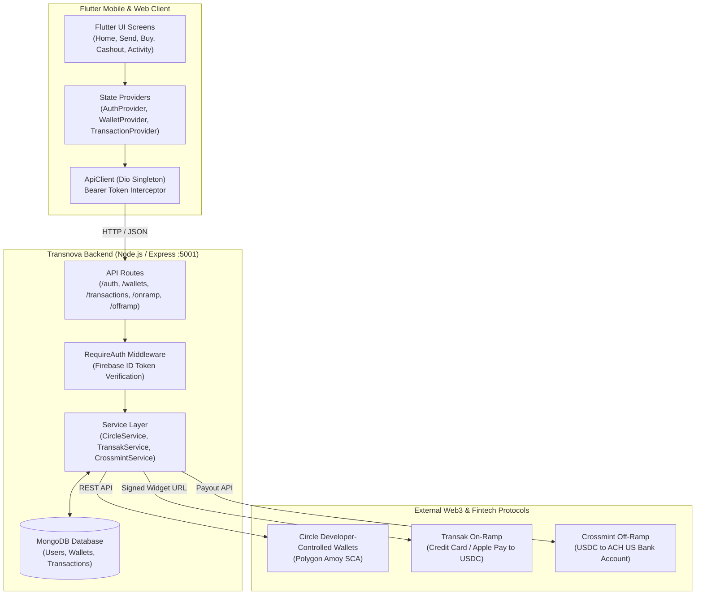

# 💳 Transnova E-Wallet Mobile Application

A modern, high-fidelity cross-platform digital e-wallet and global stablecoin payouts application built with **Flutter 3.47+**, **Dart 3.13+**, and **Provider** state management. The app interfaces with a Node.js Express backend powering **Circle Developer-Controlled Wallets** (Smart Contract Accounts on **Polygon Amoy testnet**), **Transak On-Ramp** (fiat-to-USDC), and **Crossmint Off-Ramp** (USDC-to-ACH US bank payouts).

The UI is inspired by modern fintech mobile design systems featuring clean card elevations, vibrant coral branding, and smooth micro-interactions.

---

## 📑 Table of Contents
- [Architecture & Tech Stack](#-architecture--tech-stack)
- [System Architecture Diagram](#-system-architecture-diagram)
- [Key Features](#-key-features)
- [Project Directory Structure](#-project-directory-structure)
- [State Management Architecture](#-state-management-architecture)
- [Core User Flows & Screen Breakdown](#-core-user-flows--screen-breakdown)
- [API & Backend Integration](#-api--backend-integration)
- [Getting Started & Local Setup](#-getting-started--local-setup)
- [Configuration & Environment Variables](#-configuration--environment-variables)
- [Troubleshooting & FAQ](#-troubleshooting--faq)

---

## 🛠 Architecture & Tech Stack

| Layer | Technologies / Packages | Purpose |
|---|---|---|
| **Framework** | Flutter 3.47.x / Dart 3.13.x | Cross-platform frontend targeting Web, iOS, Android, and macOS desktop |
| **State Management** | `provider: ^6.1.5` | Reactive dependency injection and business logic separation |
| **Networking** | `dio: ^5.11.1` | Robust HTTP client with Bearer auth interceptors & dynamic base URL updating |
| **Local Storage** | `shared_preferences: ^2.5.6` | Client-side persistence for auth tokens and server configuration |
| **Typography & Styling** | `google_fonts: ^9.0.0` | Plus Jakarta Sans (UI body/headers) & JetBrains Mono (crypto addresses/hashes) |
| **Visual Components** | `qr_flutter: ^4.1.0` | Client-side vector QR code rendering for USDC deposit addresses |
| **Web & Deep Links** | `url_launcher: ^6.3.3` | Launching external Transak on-ramp checkout portals & Polygonscan explorers |
| **Formatting** | `intl: ^0.20.3` | Currency formatting (`$1,250.00`) and human-readable transaction timestamps |

---

## 🏛 System Architecture Diagram



---

## 🚀 Key Features

### 1. 🪙 Circle Developer-Controlled Wallets (SCA)
- Automatically provisions **Polygon Amoy** Smart Contract Accounts (ERC-4337 SCA) for authenticated users.
- Live token balance polling querying Circle SDK token endpoints.
- Address validation to prevent sending USDC to invalid EVM addresses.
- Interactive Receive sheet with vector QR codes and one-tap clipboard copy.

### 2. ⚡ Fast USDC Transfers & Gas Fee Estimation
- Multi-tier gas estimation (Standard, Fast, Instant) before executing transactions.
- Direct blockchain execution via Circle developer-controlled wallet transfer endpoints.
- Sandbox simulation mode for testing transfers without spending testnet gas.
- Recent recipient contact chips (Alice, Bob, Charlie, Sarah) for quick autofill.

### 3. 💳 Transak On-Ramp (Buy USDC)
- Integration with Transak widget checkout sessions.
- Dynamic fiat currency support (USD, EUR, GBP) with real-time conversion estimates.
- One-click simulated top-up button for instant local testnet credits.

### 4. 🏦 Crossmint Off-Ramp (Cash Out to US Bank)
- Link ACH checking/savings bank accounts (routing & account number).
- Off-ramp order creation from Polygon USDC directly to US bank accounts.
- Sandbox cash-out simulation for end-to-end payout flow testing.

### 5. 📜 Activity & Transaction History
- Inflow vs. Outflow monthly summary cards.
- Multi-filter category chips (`All`, `Transfers`, `Deposits`, `Cash Out`).
- Transaction detail bottom sheets with Circle ID, reference numbers, and timestamps.

### 6. 🎨 High-Fidelity UI System
- Vibrant Coral-Red primary palette (`#FF4B4B`).
- Clean white card elevations with soft diffuse drop shadows (`BoxShadow`).
- Custom elevated bottom navigation bar with a dedicated center **SCAN** button.
- Clean eye visibility toggle to conceal account balances in public environments.

---

## 📂 Project Directory Structure

```
transnova_flutter/
├── lib/
│   ├── config/                     # Application configurations & styling
│   │   ├── api_config.dart         # Backend endpoints registry & platform URL resolution
│   │   └── theme.dart              # Fintech Coral palette, typography, and card shadows
│   │
│   ├── models/                     # Strongly-typed Dart data models
│   │   ├── fee_estimate_model.dart # Circle gas estimation response model
│   │   ├── offramp_model.dart      # Crossmint ACH beneficiary & payout order models
│   │   ├── onramp_order_model.dart # Transak checkout order model
│   │   ├── transaction_model.dart  # Unified transaction model for all transfers
│   │   ├── user_model.dart         # User profile model
│   │   └── wallet_model.dart       # Circle Smart Contract Account & token balance model
│   │
│   ├── providers/                  # State management controllers (ChangeNotifier)
│   │   ├── auth_provider.dart      # User login, registration, token persistence & demo session
│   │   ├── transaction_provider.dart# Transfer execution, gas estimation & activity history
│   │   └── wallet_provider.dart    # Circle wallet provisioning, address & balance management
│   │
│   ├── screens/                    # UI screens and views
│   │   ├── activity/
│   │   │   └── activity_screen.dart # History screen with inflow/outflow cards & filters
│   │   ├── auth/
│   │   │   ├── login_screen.dart   # Email/password login with Quick Demo Login
│   │   │   └── register_screen.dart# User account creation screen
│   │   ├── buy/
│   │   │   └── buy_screen.dart     # Transak on-ramp purchase screen
│   │   ├── cashout/
│   │   │   └── cashout_screen.dart # Crossmint ACH bank cash out screen
│   │   ├── home/
│   │   │   ├── home_screen.dart    # Main dashboard view
│   │   │   └── widgets/
│   │   │       ├── balance_card.dart# Floating white balance card with action buttons
│   │   │       ├── promo_banner.dart# Promotional zero-gas banner card
│   │   │       ├── receive_modal.dart# Modal with vector QR code and address copy
│   │   │       └── services_grid.dart# 4x2 grid of service buttons (Transfer, Bill, More)
│   │   ├── send/
│   │   │   └── send_screen.dart    # USDC transfer screen with contacts & fee tiers
│   │   ├── settings/
│   │   │   └── settings_screen.dart# Profile, Circle wallet ID, server URL & logout
│   │   ├── main_navigation.dart    # 5-item bottom navigation bar with elevated SCAN button
│   │   └── splash_screen.dart      # Animated startup screen with auto-session check
│   │
│   ├── services/                   # HTTP service client implementations (Dio)
│   │   ├── api_client.dart         # Singleton HTTP client with Bearer auth interceptor
│   │   ├── auth_service.dart       # Auth REST requests (login, register, sync, me)
│   │   ├── offramp_service.dart    # Crossmint ACH beneficiary & order HTTP calls
│   │   ├── onramp_service.dart     # Transak widget URL generation HTTP calls
│   │   ├── transaction_service.dart# Transfer execution & gas fee estimate HTTP calls
│   │   └── wallet_service.dart     # Circle wallet provisioning & balance HTTP calls
│   │
│   ├── widgets/                    # Global reusable UI components
│   │   └── app_top_bar.dart        # Coral red top app bar with circular back button
│   └── main.dart                   # Application entry point & MultiProvider setup
│
├── pubspec.yaml                    # Flutter dependencies and assets manifest
└── README.md                       # Comprehensive project documentation
```

---

## 🧠 State Management Architecture

The application uses **Provider** (`ChangeNotifier`) for clean separation of concerns:

### `AuthProvider` (`lib/providers/auth_provider.dart`)
- **`user`**: Stores current authenticated `UserModel`.
- **`checkSession()`**: Inspects local storage for a previously saved Bearer token on app startup.
- **`login(email, password)`**: Authenticates via the backend and stores the returned ID token. Supports instant one-click login via `demo@transnova.com`.
- **`register(email, password, displayName)`**: Registers a new user and syncs profile.
- **`logout()`**: Clears tokens and resets all provider states.

### `WalletProvider` (`lib/providers/wallet_provider.dart`)
- **`wallet`**: Holds the user's active `WalletModel` (Circle SCA address, wallet ID, token balances).
- **`usdcBalance`**: Extracted double value of available USDC.
- **`initWallet()`**: Requests backend `/wallets/circle` to create or retrieve the user's Polygon Amoy Smart Contract Account.
- **`refreshBalance()`**: Re-fetches token balances from Circle SDK.
- **`validateAddress(address)`**: Verifies whether a destination address is valid.

### `TransactionProvider` (`lib/providers/transaction_provider.dart`)
- **`transactions`**: List of user transaction history.
- **`estimateFee(walletId, destinationAddress, amount)`**: Fetches low/medium/high gas estimations.
- **`sendCircleTransfer(walletId, destinationAddress, amount)`**: Submits on-chain Circle USDC transfer.
- **`simulateTransaction(type, amount, asset)`**: Simulates instant testnet transaction credit.

---

## 🔄 Core User Flows & Screen Breakdown

### 1. App Startup (`SplashScreen`)
- `SplashScreen` displays the circular brand emblem and calls `authProvider.checkSession()`.
- If an auth token is found, it automatically initializes the user's wallet via `walletProvider.initWallet()` and routes to `MainNavigation`.
- If no session exists, it navigates to `LoginScreen`.

### 2. Login & Registration (`LoginScreen`)
- Enter email and password to sign in.
- **Quick Demo Login Button**: Automatically inputs `demo@transnova.com`, creates a local dev session, and loads the dashboard immediately without waiting on third-party auth services.
- **Server Config Modal**: Tap the gear icon in the top right to change the backend API URL (useful when switching between local machine and cloud servers).

### 3. Home Dashboard (`HomeScreen`)
- Displays the user greeting and notification badge in the coral header.
- **Floating Balance Card**: Shows total USDC balance, Polygon Amoy status pill, and 4 quick action buttons (**Send**, **Top Up**, **Withdraw**, **Receive**).
- **Services Grid**: 8 squircle shortcuts for Transfer, Top Up, Withdraw, QR Pay, Utilities, and Vouchers.
- **Promotional Card**: Highlights current promotions (e.g. 0% gas fee week).
- **Recent Activity**: Filter transactions by type with status indicators.

### 4. Transfer USDC (`SendScreen`)
- Displays available USDC balance.
- **Recent Recipients**: Tap avatar circles (Alice, Bob, Charlie, Sarah) to immediately populate the destination address.
- Enter amount with quick preset buttons (`$10`, `$25`, `$50`, `$100`, `MAX`).
- Select Network Gas Speed (Standard, Fast, Instant).
- Tap **Confirm & Send** to execute on-chain transfer.

### 5. Receive USDC (`ReceiveModal`)
- Accessible by tapping "Receive" on the balance card or the bottom center **SCAN** button.
- Generates a vector QR code representing the user's Polygon Amoy Smart Contract Account.
- Tap **Copy Address** to copy the full EVM address to clipboard.

### 6. Top Up USDC (`BuyScreen`)
- Enter fiat amount to purchase USDC.
- Tap **Continue with Transak** to open the Transak on-ramp portal in an external browser.
- Tap **Instant Simulated Deposit** for instant sandbox balance top-ups during development.

### 7. Cash Out to Bank (`CashoutScreen`)
- Enter withdrawal amount.
- Displays linked ACH bank account details (Wells Fargo Checking).
- Tap **Withdraw to Bank** to execute the Crossmint payout order.

---

## 🌐 API & Backend Integration

The app expects the `transnova_backend` Node.js server running on port `5001`.

All requests pass through `ApiClient` (powered by Dio), which automatically attaches the Bearer token:
```http
Authorization: Bearer <ID_TOKEN>
Content-Type: application/json
```

### Main Endpoints:
| Method | Endpoint | Description |
|---|---|---|
| `POST` | `/api/v1/auth/sync` | Synchronize Firebase profile with MongoDB |
| `GET` | `/api/v1/auth/me` | Get current user profile |
| `POST` | `/api/v1/wallets/circle` | Auto-provision Polygon Amoy Smart Contract Account |
| `GET` | `/api/v1/wallets/:id/balance` | Query live USDC token balance |
| `POST` | `/api/v1/wallets/validate-address` | Verify EVM address validity |
| `POST` | `/api/v1/transactions/estimate-fee` | Estimate Circle transfer gas fees |
| `POST` | `/api/v1/transactions/circle-transfer` | Execute on-chain Circle USDC transfer |
| `GET` | `/api/v1/transactions` | Fetch user transaction history list |
| `POST` | `/api/v1/transactions/simulate` | Simulate sandbox transaction |
| `POST` | `/api/v1/onramp/widget-url` | Generate Transak checkout session URL |
| `POST` | `/api/v1/offramp/payment-methods` | Link Crossmint ACH bank account |
| `POST` | `/api/v1/offramp/orders` | Submit Crossmint ACH cashout order |

---

## 💻 Getting Started & Local Setup

### Prerequisites
- [Flutter SDK](https://flutter.dev/docs/get-started/install) (`>= 3.47.0`)
- [Dart SDK](https://dart.dev/get-dart) (`>= 3.13.0`)
- [Node.js](https://nodejs.org/) (`>= 18.0.0`) for running the backend
- Modern web browser (Chrome, Safari, Firefox) or mobile emulator

### 1. Start the Backend Server
In a separate terminal window:
```bash
cd transnova_backend
npm install
npm run dev
```
Verify the backend is active by opening: [http://localhost:5001/health](http://localhost:5001/health) (should respond `{"status":"ok"}`).

### 2. Run the Flutter Frontend

#### Running on Web (Recommended for quick testing):
```bash
cd transnova_flutter
flutter pub get
flutter run -d web-server --web-port 8080 --web-hostname 127.0.0.1
```
Open [http://127.0.0.1:8080](http://127.0.0.1:8080) in your browser.

#### Running on macOS Desktop:
```bash
flutter run -d macos
```

#### Running on Android Emulator:
```bash
flutter run -d android
```
*(Note: When running on Android emulator, the app automatically connects to `http://10.0.2.2:5001` to communicate with your host computer's backend).*

---

## 🔧 Configuration & Environment Variables

### Dynamic Base URL Switcher
You don't need to rebuild the application to change the backend target:
1. On the **Login Screen**, tap the **Settings** icon in the top right.
2. Or go to **Profile / Settings** screen inside the app -> **Network & Server** -> **Change**.
3. Enter your target URL (e.g. `http://localhost:5001` or your deployed server `https://api.transnova.com`) and tap **Save**.
4. The setting persists across app restarts using `SharedPreferences`.

---

## ❓ Troubleshooting & FAQ

#### Q: Getting `Operation 'users.findOne()' buffering timed out after 10000ms`?
- **Cause**: The backend could not connect to MongoDB Atlas because your public IP address is not whitelisted.
- **Solution**:
  1. Open your [MongoDB Atlas Dashboard](https://cloud.mongodb.com/).
  2. Go to **Security** -> **Network Access**.
  3. Click **Add IP Address** -> Select **Allow Access From Anywhere (`0.0.0.0/0`)** or add your current public IP.
  4. Click **Confirm**. The backend will connect automatically once Atlas finishes applying the rule.
  *(Note: The backend now includes offline resilience, so transfers in dev mode continue to work even if MongoDB is temporarily unreachable).*

#### Q: How do I trigger Hot Reload while running via `web-server`?
- In the terminal running `flutter run`, press:
  - `r`: Hot Reload (updates UI changes instantly).
  - `R`: Hot Restart (resets app state and restarts).

#### Q: How do I log in without setting up Firebase Auth?
- On the login screen, click the **Quick Demo Login** button with the lightning bolt icon. It automatically authenticates as `demo@transnova.com` and creates an active session.

---

## 📄 License
This project is licensed under the ISC License.
