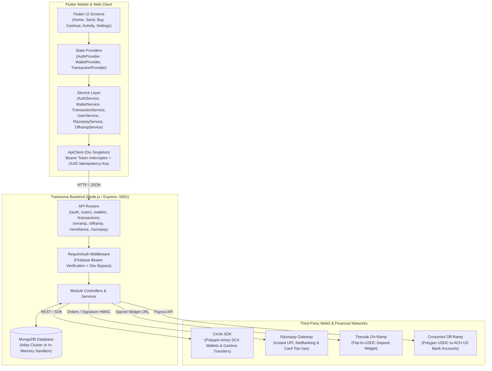

# 💳 Transnova E-Wallet Mobile Application

A production-grade, cross-platform digital e-wallet and global stablecoin remittance application built with **Flutter 3.47+**, **Dart 3.13+**, and **Provider** state management. The app interfaces with a Node.js Express backend powering **Circle Developer-Controlled Wallets** (Smart Contract Accounts on **Polygon Amoy testnet**), **Transak On-Ramp** (fiat-to-USDC), **Crossmint Off-Ramp** (USDC-to-ACH US bank payouts), and **Razorpay Instant Top-Ups** (UPI, Net Banking, and Cards).

The UI is inspired by modern fintech mobile design systems featuring clean card elevations, vibrant coral branding (`#FF4B4B`), responsive mobile frame rendering, and smooth micro-interactions.

---

## 📑 Table of Contents
- [Architecture & Tech Stack](#-architecture--tech-stack)
- [System Architecture Diagram](#-system-architecture-diagram)
- [Key Features](#-key-features)
- [Project Directory Structure](#-project-directory-structure)
- [State Management Architecture](#-state-management-architecture)
- [Complete API Endpoint Registry](#-complete-api-endpoint-registry)
- [Core User Flows & Screen Breakdown](#-core-user-flows--screen-breakdown)
- [Safety, Idempotency & Financial Resilience](#-safety-idempotency--financial-resilience)
- [Getting Started & Local Setup](#-getting-started--local-setup)
- [Configuration & Environment Variables](#-configuration--environment-variables)
- [Troubleshooting & FAQ](#-troubleshooting--faq)

---

## 🛠 Architecture & Tech Stack

### Frontend (Flutter Client)
| Layer | Technologies / Packages | Purpose |
|---|---|---|
| **Framework** | Flutter 3.47.x / Dart 3.13.x | Cross-platform frontend targeting Web, iOS, Android, and macOS desktop |
| **State Management** | `provider: ^6.1.5` | Reactive dependency injection, clean state separation, and UI rebuild isolation |
| **Networking** | `dio: ^5.11.1` | HTTP client with automatic Bearer token interceptor, dynamic base URL sync, and unified error parsing |
| **Idempotency** | `uuid: ^4.6.0` | RFC4122 v4 UUID generation for retry-safe money-moving HTTP headers |
| **Local Storage** | `shared_preferences: ^2.5.6` | Client-side persistence for auth tokens and user server configurations |
| **Typography & Styling** | `google_fonts: ^9.0.0` | Plus Jakarta Sans (UI body/headers) & JetBrains Mono (crypto addresses/hashes) |
| **Visual Components** | `qr_flutter: ^4.1.0` | Vector QR code rendering for USDC deposit addresses and payment links |
| **Web & Deep Links** | `url_launcher: ^6.3.3` | Launching external Transak on-ramp checkout portals & Polygonscan explorers |
| **Formatting** | `intl: ^0.20.3` | Currency formatting (`$1,250.00`) and human-readable transaction timestamps |

### Backend (Node.js Express Server)
| Component | Technologies | Purpose |
|---|---|---|
| **Runtime** | Node.js `>= 18.0.0` / Express 5 | High-throughput REST API with Zod payload validation |
| **Authentication** | Firebase Admin SDK | Cryptographic Firebase ID Token verification with dev token bypass for local QA |
| **Database** | MongoDB / Mongoose 9 | User profiles, Circle wallet mappings, payment methods, and transaction ledger |
| **In-Memory Fallback**| `mongodb-memory-server` | Zero-configuration local database sandbox that boots when Atlas is unreachable |
| **Blockchain** | Circle Developer-Controlled Wallets | ERC-4337 Smart Contract Accounts (SCA) deployed on Polygon Amoy testnet |
| **Domestic Payments** | Razorpay SDK | Domestic INR collections, UPI checkouts, and HMAC-SHA256 signature verification |
| **Fiat On-Ramp** | Transak API | Signed widget session URLs for purchasing USDC with credit cards / fiat |
| **Fiat Off-Ramp** | Crossmint API | ACH bank account linking and payout orders directly to US checking/savings accounts |

---

## 🏛 System Architecture Diagram



---

## 🚀 Key Features

### 1. 🪙 Circle Developer-Controlled Wallets (SCA)
- Automatically provisions **Polygon Amoy** Smart Contract Accounts (ERC-4337 SCA) upon user registration/sync.
- Live token balance polling directly querying Circle SDK token endpoints.
- Permanent on-chain address generation and address validation against Polygon Amoy network standards.
- Interactive Receive bottom sheet with high-resolution vector QR code and one-tap clipboard copy.

### 2. ⚡ Fast USDC Transfers & Gas Fee Estimation
- Multi-tier gas estimation (**Standard**, **Fast**, **Instant**) before executing transactions.
- Send transfers using either **Polygon addresses (`0x...`)** or **Transnova user email addresses**.
- **Real-Time Recipient Verification**: As soon as a user types an email address, the frontend calls the backend to verify the recipient's identity and displays `Verified: [Display Name]`.
- **Sandbox Ledger Fallback**: In local development or demo mode, transfers execute seamlessly in the sandbox ledger even if testnet faucets are offline.

### 3. 💳 Transak On-Ramp (Buy USDC)
- Seamless integration with Transak widget checkout sessions.
- Multi-currency fiat support (USD, EUR, GBP, INR) with real-time conversion estimates.
- One-click simulated deposit button for instant local testnet credits.

### 4. 🏦 Crossmint Off-Ramp (Cash Out to US Bank)
- Link ACH checking/savings bank accounts (routing & account number).
- Off-ramp order creation from Polygon USDC directly to US bank accounts.
- Automated payout status polling and reconciliation.

### 5. 🌐 Cross-Border Multi-Hop Remittance Pipeline (Flow 1)
- End-to-end international remittance flow: **Sender INR (Transak / UPI) → Polygon USDC → Recipient USD Bank Account (Crossmint ACH)**.
- Full multi-stage lifecycle tracking with live progress timeline events.
- Transparent exchange rate and network fee breakdown.

### 6. ⚡ Instant INR / UPI Top-Up via Razorpay
- Domestic fiat top-up supporting UPI (Google Pay, PhonePe, Paytm), Net Banking, and Cards.
- Order creation with `Idempotency-Key` headers (`POST /api/v1/razorpay/create-order`).
- Server-side cryptographic HMAC-SHA256 signature verification (`POST /api/v1/razorpay/verify-payment`).
- Verified payment receipt retrieval (`GET /api/v1/razorpay/payment/:orderId/receipt`).

### 7. 🧾 Immutable Transaction Receipts
- Both Circle transfers and Razorpay orders generate immutable, Flutter-friendly receipts.
- Easily accessible via `GET /api/v1/transactions/:id/receipt` and `GET /api/v1/razorpay/payment/:orderId/receipt`.

### 8. 📜 Activity & Transaction History
- Inflow vs. Outflow monthly summary cards.
- Category filter chips (`All`, `Transfers`, `Deposits`, `Cash Out`).
- Interactive transaction detail cards showing status, hash/reference, network, and timestamps.

### 9. 🎨 Modern Fintech UI & UX
- Custom elevated bottom navigation bar with a dedicated center **SCAN** button.
- Floating balance card with an eye visibility toggle to conceal balances in public.
- Auto-playing 3-slide promotional carousel with smooth page indicators.
- Responsive phone frame wrapper when running on Web or Desktop for optimal presentation.

---

## 📂 Project Directory Structure

```
transnova_flutter/
├── lib/
│   ├── config/                     # Application configurations & styling
│   │   ├── api_config.dart         # Backend endpoints registry & platform URL resolution
│   │   └── theme.dart              # Fintech Coral palette (#FF4B4B), typography, and shadows
│   │
│   ├── models/                     # Strongly-typed Dart data models
│   │   ├── fee_estimate_model.dart # Circle gas estimation response model
│   │   ├── offramp_model.dart      # Crossmint ACH beneficiary & payout order models
│   │   ├── onramp_order_model.dart # Transak checkout order model
│   │   ├── razorpay_model.dart     # Razorpay order and payment verification model
│   │   ├── receipt_model.dart      # Transaction and Razorpay immutable receipt models
│   │   ├── recipient_model.dart    # Verified recipient public wallet resolution model
│   │   ├── remittance_model.dart   # Cross-border multi-hop remittance pipeline model
│   │   ├── transaction_model.dart  # Unified transaction model for all transfers
│   │   ├── user_model.dart         # User profile model
│   │   └── wallet_model.dart       # Circle Smart Account, token balance & QR model
│   │
│   ├── providers/                  # State management controllers (ChangeNotifier)
│   │   ├── auth_provider.dart      # User login, registration, token persistence & demo session
│   │   ├── transaction_provider.dart# Transfer execution, gas estimation & activity history
│   │   └── wallet_provider.dart    # Circle wallet provisioning, address & balance management
│   │
│   ├── screens/                    # UI screens and views
│   │   ├── activity/
│   │   │   └── activity_screen.dart # History screen with inflow/outflow cards & filters
│   │   ├── auth/
│   │   │   ├── login_screen.dart   # Email/password login with Quick Demo Login
│   │   │   └── register_screen.dart# User account creation screen
│   │   ├── buy/
│   │   │   └── buy_screen.dart     # Transak on-ramp purchase screen
│   │   ├── cashout/
│   │   │   └── cashout_screen.dart # Crossmint ACH bank cash out screen
│   │   ├── home/
│   │   │   ├── home_screen.dart    # Main dashboard view
│   │   │   └── widgets/
│   │   │       ├── balance_card.dart# Floating white balance card with action buttons
│   │   │       ├── promo_banner.dart# 3-slide auto-playing promotional carousel
│   │   │       ├── razorpay_topup_modal.dart# Instant UPI / RuPay top-up bottom sheet
│   │   │       ├── receive_modal.dart# Modal with vector QR code and address copy
│   │   │       ├── remittance_modal.dart# Cross-border multi-hop remittance flow & tracker
│   │   │       └── services_grid.dart# 4x2 grid of service buttons (Transfer, Remit, UPI, etc.)
│   │   ├── send/
│   │   │   └── send_screen.dart    # USDC transfer screen (supports address or email with lookup)
│   │   ├── settings/
│   │   │   └── settings_screen.dart# Profile, Circle wallet ID, live health indicator & server URL
│   │   ├── main_navigation.dart    # 5-item bottom navigation bar with elevated SCAN button
│   │   └── splash_screen.dart      # Animated startup screen with auto-session check
│   │
│   ├── services/                   # HTTP service client implementations (Dio)
│   │   ├── api_client.dart         # Singleton HTTP client with Bearer auth interceptor & health check
│   │   ├── auth_service.dart       # Auth REST requests (login, register, sync, me)
│   │   ├── offramp_service.dart    # Crossmint ACH beneficiary & order HTTP calls
│   │   ├── onramp_service.dart     # Transak widget URL generation HTTP calls
│   │   ├── razorpay_service.dart   # Razorpay order generation, signature verification & receipts
│   │   ├── remittance_service.dart # End-to-end multi-hop remittance pipeline calls
│   │   ├── transaction_service.dart# Circle USDC transfers, fee estimation, receipts & demo funding
│   │   ├── user_service.dart       # Recipient public wallet lookup by email
│   │   └── wallet_service.dart     # Circle wallet creation, primary wallet & balance checks
│   │
│   ├── widgets/                    # Global reusable UI components
│   │   └── app_top_bar.dart        # Coral red top app bar with circular back button
│   └── main.dart                   # Application entry point & MultiProvider setup
│
├── pubspec.yaml                    # Flutter dependencies and assets manifest
└── README.md                       # Comprehensive project documentation
```

---

## 🧠 State Management Architecture

The application uses **Provider** (`ChangeNotifier`) for clean separation between UI components and business logic:

### 1. `AuthProvider` (`lib/providers/auth_provider.dart`)
- **`user`**: Stores current authenticated `UserModel`.
- **`checkSession()`**: Inspects local storage for a previously saved Bearer token on app startup.
- **`login(email, password)`**: Authenticates via backend REST API and saves the token. Supports instant one-click login via `demo@transnova.com`.
- **`register(email, password, displayName)`**: Registers a new user and syncs profile with the backend.
- **`logout()`**: Clears local storage tokens and resets provider state.

### 2. `WalletProvider` (`lib/providers/wallet_provider.dart`)
- **`wallet`**: Holds the user's active `WalletModel` (Circle SCA address, wallet ID, token balances).
- **`qr`**: Holds the user's permanent `WalletQrModel` (address, QR payload, payment URI, and base64 PNG).
- **`usdcBalance`**: Extracted double value of available USDC.
- **`initWallet()`**: Requests `GET /api/v1/wallets/me` first, falling back to `POST /api/v1/wallets/circle` if the user is newly registered.
- **`refreshBalance()`**: Re-fetches token balances from Circle SDK.
- **`validateAddress(address)`**: Verifies destination address format against Polygon standards.

### 3. `TransactionProvider` (`lib/providers/transaction_provider.dart`)
- **`transactions`**: List of user transaction history.
- **`estimateFee(walletId, destinationAddress, recipientEmail, amount)`**: Fetches low/medium/high gas estimations.
- **`sendCircleTransfer(walletId, destinationAddress, recipientEmail, amount, feeLevel)`**: Submits on-chain Circle USDC transfer with an auto-generated UUID `Idempotency-Key` header.
- **`simulateTransaction(type, amount, asset)`**: Simulates instant testnet transaction credit.

---

## 🌐 Complete API Endpoint Registry

All requests pass through `ApiClient` (powered by Dio), which automatically injects:
```http
Authorization: Bearer <ID_TOKEN>
Content-Type: application/json
```
For value-creating endpoints, an RFC4122 v4 UUID `Idempotency-Key` header is automatically generated:

| Domain | Method | Endpoint | Description | Idempotency Key? |
|---|---|---|---|---|
| **System** | `GET` | `/health` | Server health check; returns `{"status":"ok"}` | No |
| **Auth** | `POST` | `/api/v1/auth/sync` | Sync Firebase profile & auto-provision Circle wallet | No |
| **Auth** | `GET` | `/api/v1/auth/me` | Fetch authenticated profile, wallet, and QR | No |
| **Users** | `GET` | `/api/v1/users/recipient?email=<email>` | Resolve recipient's public wallet & display name | No |
| **Wallets** | `GET` | `/api/v1/wallets/me` | Current user's primary Circle wallet & QR | No |
| **Wallets** | `POST` | `/api/v1/wallets/circle` | Explicitly provision Polygon Amoy SCA wallet | No |
| **Wallets** | `GET` | `/api/v1/wallets/:id/balance` | Query live USDC token balance from Circle | No |
| **Wallets** | `GET` | `/api/v1/wallets/:id/qr` | Fetch permanent QR code payload for a wallet | No |
| **Wallets** | `POST` | `/api/v1/wallets/validate-address` | Validate destination blockchain address | No |
| **Transactions** | `POST` | `/api/v1/transactions/estimate-fee` | Estimate transfer gas fee (supports address or email) | No |
| **Transactions** | `POST` | `/api/v1/transactions/circle-transfer` | Execute on-chain Circle USDC transfer | **Yes** (`Idempotency-Key`) |
| **Transactions** | `GET` | `/api/v1/transactions/circle/:circleId` | Poll on-chain Circle transfer status | No |
| **Transactions** | `GET` | `/api/v1/transactions/:id/receipt` | Get immutable transaction receipt | No |
| **Transactions** | `GET` | `/api/v1/transactions` | Fetch user transaction history list | No |
| **Transactions** | `POST` | `/api/v1/transactions/simulate` | Simulate sandbox transaction | No |
| **On-ramp** | `POST` | `/api/v1/onramp/widget-url` | Generate signed Transak checkout session URL | No |
| **On-ramp** | `GET` | `/api/v1/onramp/transactions/:id` | Poll Transak deposit status | No |
| **Off-ramp** | `POST` | `/api/v1/offramp/payment-methods` | Link Crossmint ACH US bank account | No |
| **Off-ramp** | `GET` | `/api/v1/offramp/payment-methods` | List saved bank payment methods | No |
| **Off-ramp** | `POST` | `/api/v1/offramp/orders` | Submit Crossmint ACH cashout order | **Yes** (`Idempotency-Key`) |
| **Off-ramp** | `GET` | `/api/v1/offramp/orders/:id` | Poll payout provider status | No |
| **Remittance** | `POST` | `/api/v1/remittance/initiate` | Initiate end-to-end multi-hop remittance | **Yes** (`Idempotency-Key`) |
| **Remittance** | `GET` | `/api/v1/remittance/:id` | Poll remittance pipeline progress and timeline | No |
| **Remittance** | `GET` | `/api/v1/remittance` | List user's remittance history | No |
| **Razorpay** | `POST` | `/api/v1/razorpay/create-order` | Create INR payment order for UPI/Card top-up | **Yes** (`Idempotency-Key`) |
| **Razorpay** | `POST` | `/api/v1/razorpay/verify-payment` | Verify checkout signature (orderId, paymentId, sig) | No |
| **Razorpay** | `GET` | `/api/v1/razorpay/payment/:orderId` | Poll Razorpay payment status | No |
| **Razorpay** | `GET` | `/api/v1/razorpay/payment/:orderId/receipt` | Fetch verified Razorpay payment receipt | No |
| **Razorpay** | `GET` | `/api/v1/razorpay/history` | List user's Razorpay payment history | No |
| **Dev Tools** | `POST` | `/api/v1/dev/demo/fund` | Credit demo USDC to sandbox wallet | No |

---

## 🔒 Safety, Idempotency & Financial Resilience

1. **Idempotency Key Protection**:
   - Every value-creating request (`/transactions/circle-transfer`, `/razorpay/create-order`, `/offramp/orders`) generates a fresh RFC4122 v4 UUID attached to the `Idempotency-Key` HTTP header.
   - If a mobile connection drops and retries the same request, the backend detects the idempotency key and prevents duplicate debits or double orders.

2. **Offline Resilience & In-Memory MongoDB Sandbox**:
   - If the backend is unable to connect to MongoDB Atlas (e.g. IP whitelist restrictions or traveling on a new network), the server automatically boots an in-memory database sandbox (`mongodb-memory-server`) in ~2 seconds.
   - The developer is never blocked by database connection timeouts.

3. **Privacy-Preserving Recipient Lookup**:
   - `GET /api/v1/users/recipient?email=<email>` deliberately exposes public payment information only (`displayName`, `walletAddress`, `blockchain`, `asset`). It never leaks internal database IDs, phone numbers, or KYC details.

---

## 💻 Getting Started & Local Setup

### Prerequisites
- [Flutter SDK](https://flutter.dev/docs/get-started/install) (`>= 3.47.0`)
- [Dart SDK](https://dart.dev/get-dart) (`>= 3.13.0`)
- [Node.js](https://nodejs.org/) (`>= 18.0.0`) for running the backend
- Modern web browser (Chrome, Safari, Firefox) or mobile emulator

### 1. Start the Backend Server
In your terminal:
```bash
cd transnova_backend
npm install
node src/server.js
```
Verify the backend is active:
```bash
curl http://localhost:5001/health
# Response: {"status":"ok"}
```

### 2. Run the Flutter Frontend

#### Running on Web (Recommended for quick testing):
```bash
cd transnova_flutter
flutter pub get
flutter run -d web-server --web-port 8080 --web-hostname localhost
```
Open [http://localhost:8080](http://localhost:8080) in your browser.

#### Running on macOS Desktop:
```bash
flutter run -d macos
```

#### Running on Android Emulator:
```bash
flutter run -d android
```
*(Note: When running on Android emulator, the app automatically defaults to `http://10.0.2.2:5001` to communicate with your host computer's backend).*

---

## 🔧 Configuration & Environment Variables

### Dynamic Base URL Switcher
By default, the application is linked to the deployed Render backend:
```
https://transnova-backend.onrender.com
```
You can switch between Render Cloud and Localhost at any time:
1. On the **Login Screen**, tap the **Settings** gear icon in the top right.
2. Or go to **Settings Screen** inside the app -> **Network & Server** -> **Change**.
3. Tap **☁️ Render** (`https://transnova-backend.onrender.com`) or **💻 Localhost** (`http://localhost:5001`), then tap **Save**.
4. The setting persists across app restarts using `SharedPreferences`.

---

## ❓ Troubleshooting & FAQ

#### Q: Getting `Operation 'users.findOne()' buffering timed out after 10000ms`?
- **Cause**: MongoDB Atlas rejected the connection due to an unwhitelisted IP address, and Mongoose buffered queries until timing out.
- **Solution**:
  1. The backend now includes an automatic local in-memory fallback (`mongodb-memory-server`), ensuring queries never time out even if offline.
  2. If using Atlas in production, whitelist your IP in the [MongoDB Atlas Console](https://cloud.mongodb.com/) under **Security -> Network Access -> Add IP Address**.

#### Q: How do I log in instantly without Firebase setup?
- On the login screen, click the **Quick Demo Login** button with the lightning bolt icon. It automatically authenticates as `demo@transnova.com` and provisions an active session immediately.

#### Q: How do I test the UPI / RuPay top-up flow?
- Tap the **UPI TopUp** tile on the home screen services grid. Enter the desired INR amount and tap **Proceed with Razorpay**. The app generates a test checkout order and verifies the receipt.

---

## 📄 License
This project is licensed under the ISC License.
